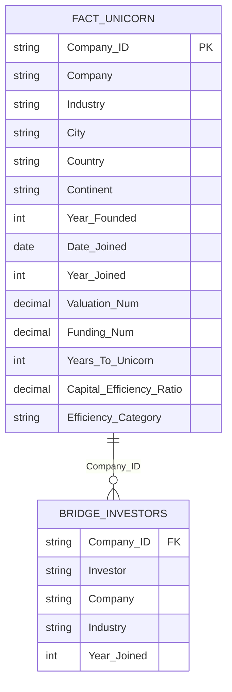
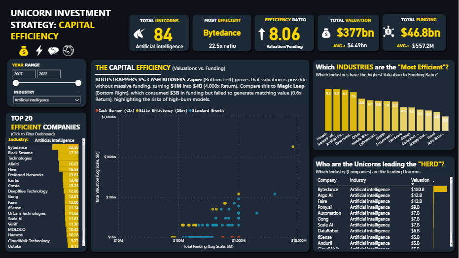

# Global Unicorn Ecosystem Analysis: Valuation, Growth & Investor Networks

**An exploratory data analysis of global unicorn ecosystems, examining
valuation, funding intensity, growth velocity, investor networks and
geographic concentration.**

**Project type:** Independent data analytics portfolio project\
**Analytical approach:** Descriptive and exploratory business analysis\
**Tools:** Microsoft SQL Server (T-SQL), Power BI\
**Focus:** Descriptive market analysis and exploratory investment
screening—not investment-return forecasting

[View the interactive Power BI
dashboard](https://app.powerbi.com/links/NDQXqXVVke?ctid=319a61c8-ee1e-4161-8f35-b9553227afd7&pbi_source=linkShare&bookmarkGuid=6aa14441-554f-4a07-b90e-b58e37eac958)
\| [Explore the SQL analysis](SQL_Query/SQL_query_for_Unicorn.sql)

> **Executive takeaway:** Unicorn valuations, disclosed funding,
> formation speed and investor relationships vary across industries and
> locations. This analysis uses those differences to identify patterns
> and candidates for further investigation. Its valuation-to-funding
> ratio is a descriptive screening measure---not ROI, an investor return
> multiple, or proof that a market is underpriced.

## Table of Contents

- [1. Project Overview](#1-project-overview)
- [2. Business Problem & Analytical Questions](#2-business-problem--analytical-questions)
- [3. Dataset Overview & Tools](#3-dataset-overview--tools)
- [4. Executive Summary](#4-executive-summary)
- [5. Key Findings & Visualizations](#5-key-findings--visualizations)
  - [5.1 Capital Efficiency](#51-capital-efficiency)
  - [5.2 Industry Growth Velocity](#52-industry-growth-velocity)
  - [5.3 Investor Networks](#53-investor-networks)
  - [5.4 Global Ecosystem Comparison](#54-global-ecosystem-comparison)
  - [5.5 Market Structure & Historical Trends](#55-market-structure--historical-trends)
- [6. Recommendations & Business Implications](#6-recommendations--business-implications)
- [7. Limitations & Further Investigation](#7-limitations--further-investigation)
- [8. Project Files & Deliverables](#8-project-files--deliverables)
- [9. Potential Extensions](#9-potential-extensions)

------------------------------------------------------------------------

## 1. Project Overview

A unicorn is a privately held company with a reported valuation of at
least **US\$1 billion**. This project examines a snapshot of global
unicorn companies to understand how reported valuation, disclosed
funding, time to unicorn status, investor relationships and geographic
distribution differ across the observed ecosystem.

The analysis compares observed unicorn companies across valuation, disclosed funding, time to unicorn status, investor participation and geographic distribution. It is a descriptive screening exercise: differences between markets are treated as evidence for further investigation, not proof of mispricing or guaranteed investment opportunity.

**Primary deliverable:** A Power BI dashboard supported by SQL Server
data preparation, company-level analysis and a separate
investor-relationship table.

[Back to Table of Contents](#table-of-contents)

## 2. Business Problem & Analytical Questions

Headline unicorn counts and aggregate valuations do not, on their own, show how efficiently companies reached unicorn status, how disclosed funding relates to reported valuation, or how investor relationships are distributed. The project therefore compares companies, industries and locations using a consistent set of measurable indicators.

**Business problem:** Identify measurable differences in reported valuation, disclosed funding, formation time, investor participation and geographic concentration across the observed unicorn population, then determine which differences warrant deeper company- or market-level research.

The analysis is organised around five questions and their corresponding measures:

1. **Valuation relative to disclosed funding:** What is the distribution of `Capital_Efficiency_Ratio = Valuation_Num / Funding_Num` among companies with positive, known funding? Report the median, mean, quartiles, minimum and maximum, plus the number and percentage of companies in each `Efficiency_Category`.
2. **Time to unicorn status:** What are the median and mean `Years_To_Unicorn = Year_Joined − Year Founded` by industry, and how many companies contribute to each estimate? Exclude zero or negative intervals from duration statistics and report the excluded count separately.
3. **Investor participation and co-investment:** How many distinct companies are associated with each investor, what share of all represented companies does that count equal, and how many distinct companies are shared by each investor pair? Count distinct `Company_ID` relationships, not bridge-table rows as companies.
4. **Geographic concentration and valuation:** What are the unicorn count, share of the observed population, median valuation and mean valuation by continent, country and city? Apply and disclose a minimum company-count threshold before ranking small geographic groups.
5. **Formation trends over time:** How many companies joined the unicorn population in each `Year_Joined`, what percentage of all dated records does each year represent, and how did industry shares change across cohorts?

**Core KPI definitions:**

| KPI | Calculation |
|---|---|
| Unicorn count | Distinct `Company_ID` count |
| Valuation-to-funding ratio | `Valuation_Num / Funding_Num`, where funding is positive and known |
| Efficiency-category share | Companies in category ÷ companies with a classified category × 100 |
| Years to unicorn | `Year_Joined − Year Founded` |
| Investor reach | Distinct companies linked to investor ÷ distinct companies in scope × 100 |
| Geographic share | Distinct companies in location ÷ distinct companies in scope × 100 |
| Annual unicorn-entry share | Companies with `Year_Joined` in year ÷ companies with a valid entry year × 100 |

These metrics describe the records available in the dataset. They do not measure realised investment returns, profitability, startup failure rates, ownership-adjusted investor value or causal effects.

[Back to Table of Contents](#table-of-contents)

## 3. Dataset Overview & Tools

The documented analysis contains **1,074 unicorn company records**. The final CSV exports should be counted at refresh time before this figure is treated as the current dashboard population. The source dataset download URL, extraction date and refresh date are not established in the project documentation.

### 3.1 Relational data structure

The model separates company-level attributes from the many-to-many investor listing by storing investor participation in a bridge table. The company fact table has one record per `Company_ID`; the bridge table has one record per distinct company-investor pair.

`Company_ID` is the join key. It is constructed from the trimmed, uppercased company name and industry; it is a dataset-specific matching key, not a permanent legal-entity identifier. The diagram shows the intended one-to-many relationship: one company record may connect to multiple investor records.

### 3.2 Data dictionary

The full field-level dictionary documents each output table, field definition, analytical role, expected data type, derivation and handling of missing or invalid values.

**[Open the full data dictionary](Global_Unicorn_Data_Dictionary.md)**

### 3.3 Tools and roles

  -----------------------------------------------------------------------
  Tool                                Role
  ----------------------------------- -----------------------------------
  Microsoft SQL Server (T-SQL)        Data preparation, currency
                                      conversion, key construction,
                                      date-derived fields, investor-list
                                      normalisation, metric calculation
                                      and analytical queries

  Power Query                         Importing the two CSV outputs and
                                      applying/confirming data types

  Power BI                            Interactive exploration, KPI
                                      reporting, segmentation and
                                      dashboard presentation
  -----------------------------------------------------------------------

[Back to Table of Contents](#table-of-contents)

## 4. Executive Summary

The documented analysis contains **1,074 unicorn company records** with an estimated combined reported valuation of approximately **$3.71 trillion**. The geographic distribution is concentrated: **562 companies are recorded in the United States**, including **148 in San Francisco** and **103 in New York**. The largest recorded entry cohort is **2021, with 520 companies**.

Industry comparisons report an average founding-to-unicorn interval of approximately **5.9 years for Artificial Intelligence** and **5.03 years for Auto & Transportation**. Internet Software accounts for **205 companies** in the analysed population. The valuation-to-funding ratio varies widely across companies, while investor co-occurrence records show repeated relationships among selected venture firms.

These figures describe the documented dataset and should be reconciled against the final CSV exports before being presented as live dashboard KPIs. The company-level and investor-relationship tables are separated through `Company_ID`, and funding records that are missing or non-positive are kept outside the classified valuation-to-funding ratio.

**Overall conclusion:** The analysis identifies measurable differences in valuation, funding, formation time, investor participation and geography that can guide further research. It does not establish realised investor returns, startup profitability, fair entry valuations, causal drivers of the 2021 increase or a uniquely optimal location for venture-capital deployment.

[Back to Table of Contents](#table-of-contents)

## 5. Key Findings & Visualizations

The findings connect each dashboard view to a measurable business question and explain what the observed metrics can—and cannot—support.

### 5.1 Capital Efficiency

**Business question:** Which companies have high or low reported
valuation relative to disclosed funding, and what should an analyst
investigate about those differences?

**Business implication:** The valuation-to-funding ratio is useful for identifying companies whose reported valuation is high or low relative to the funding disclosed in the dataset. The documented analysis identified examples such as **Zapier** and **Canva** among high-ratio observations, while **Magic Leap** and **Ola Cabs** appeared among lower-ratio observations; some observations approached **4,000×**. These are screening signals, not return multiples. A high ratio can arise from incomplete funding disclosure, differences in the dates of valuation and funding records, or a company that has raised relatively little capital. A low ratio does not establish cash burn or value destruction. For a defensible comparison, report the number of companies with positive known funding, the median and interquartile range of the ratio, and the count and percentage in each category. The category thresholds are project-defined: `Elite Efficiency (10x+)` for ratios at least 10, `Cash Burner (<2x)` for ratios below 2, `Standard Growth` for ratios from 2 to below 10, and `Not Classified` where funding is missing or non-positive. The label `Cash Burner` is a screening label only; the ratio does not measure cash burn.

[Back to Table of Contents](#table-of-contents)

### 5.2 Industry Growth Velocity

**Business question:** How does the observed time from founding to
unicorn status differ across industries?

**Business implication:** The documented analysis reports mean time-to-unicorn estimates of approximately **5.9 years for Artificial Intelligence** and **5.03 years for Auto & Transportation**. It also reports **205 Internet Software companies** and value-velocity proxies of approximately **$500 million per year** for Internet Software and **$1.1 billion per year** for AI. These figures can help identify sectors for closer examination, but the number of companies in each sector and the distribution of their durations must accompany the averages. `Years_To_Unicorn` is calculated as `Year_Joined − Year Founded`, so it is a year-level approximation rather than an exact elapsed duration. The value-velocity proxy divides reported valuation by years from founding to unicorn status; it is not annual valuation growth or an investment return. The sample includes companies that reached unicorn status and excludes unsuccessful or non-unicorn startups, so the figures cannot establish the probability that a startup in one sector will succeed faster than a startup in another.

[Back to Table of Contents](#table-of-contents)

### 5.3 Investor Networks

**Business question:** Which investors appear frequently in the unicorn
sample, and which investor pairs repeatedly appear together?

**Business implication:** Investor participation counts and co-investment frequencies can identify firms and relationships that recur across the observed unicorn population. The documented analysis reports approximately **1,247 investor names**, around **60 company relationships** associated with Accel, and approximately **$473 billion** in aggregate reported valuation across companies associated with Sequoia Capital China. It also reports nine shared companies for Sequoia China and Tencent, and six for Accel and Y Combinator. These measures describe recorded links, not investor ownership, capital deployed or investment performance. In particular, the aggregate valuation of companies associated with an investor is not the value owned by that investor. The bridge table contains one row per distinct company-investor relationship; therefore company counts must use distinct `Company_ID`, and company valuation must be aggregated from the company-level fact table rather than summed across bridge rows. Investor-name standardisation and source coverage should be checked before treating network rankings as comprehensive.

[Back to Table of Contents](#table-of-contents)

### 5.4 Global Ecosystem Comparison

**Business question:** How do unicorn counts and average reported
valuations vary across countries and cities, and which locations merit
further research?

**Business implication:** Geographic counts and valuation distributions help distinguish large startup hubs from locations with smaller observed populations and different valuation profiles. The documented analysis identifies **Austin, Hangzhou, Stockholm, Shenzhen and Boston** as locations for closer examination and reports a global sample valuation of approximately **$3.71 trillion**. For each geography, the dashboard should present distinct company count, share of the analysed population, median valuation and mean valuation together; a mean without its sample size can be misleading where a small number of companies have unusually high valuations. The analysis does not measure actual deal entry prices, funding availability, liquidity or exit performance. Consequently, a high average valuation or low company count cannot establish that a location is underpriced or offers a superior investment opportunity. Geographic comparisons should be treated as a shortlist for additional market research, not as a ranking of investment destinations.

[Back to Table of Contents](#table-of-contents)

### 5.5 Market Structure & Historical Trends

**Business question:** How did unicorn formation change over time, and
how concentrated is the observed market by geography and industry?

**Business implication:** The documented analysis records **520 unicorn entries in 2021**, followed by fewer entries in 2022, and **562 US companies** in the 1,074-record population, including **148 in San Francisco** and **103 in New York**. These figures describe the timing and concentration of companies in the observed unicorn population. Annual entry counts should be accompanied by each year's share of all records with a valid `Year_Joined`; geographic concentration should be expressed as both company counts and population shares. The 2021 peak and subsequent decline are descriptive patterns. Attributing them to interest rates, pandemic-related behaviour or a market correction requires external economic and financing evidence. The figures do not measure total venture investment, startup profitability or the number of startups created in each year.

[Back to Table of Contents](#table-of-contents)

## 6. Recommendations & Business Implications

The results support **research prioritisation**, not immediate investment execution. The recommendations connect the dashboard findings to the next evidence-gathering steps.

  ----------------------------------------------------------------------------
  Priority          Analytical opportunity Recommended       Evidence needed
                                           action            before stronger
                                                             conclusions
  ----------------- ---------------------- ----------------- -----------------
  High              Extreme                Verify funding    Consistent, dated
                    valuation-to-funding   completeness,     funding and
                    ratios                 valuation dates,  valuation records
                                           company
                                           financials and
                                           ownership
                                           structure

  High              Fast unicorn formation Review            Comparable
                    in selected industries industry/cohort   sector-level
                                           sample sizes,     measures and
                                           survivorship bias sensitivity
                                           and capital needs checks

  High              Concentrated investor  Resolve investor  Reliable investor
                    networks               aliases and       entity matching
                                           validate          and complete
                                           co-investment     round histories
                                           pairs against
                                           external records

  Medium            High-valuation but     Compare actual    Stage-adjusted
                    lower-count cities     deal entry        investment terms
                                           prices, stages,   and consistent
                                           liquidity and     geographic
                                           exits             coverage

  Ongoing           Historic unicorn waves Monitor cohorts   Dated snapshots
                                           against           and external
                                           contemporaneous   contextual data
                                           VC activity and
                                           macroeconomic
                                           indicators
  ----------------------------------------------------------------------------

### Business implications

1.  **For investment research:** Treat the dashboard as a first-stage
    screening tool. Any shortlist should proceed to company-level
    financial, market, governance and financing diligence.
2.  **For ecosystem analysis:** Compare both company counts and
    valuation distributions. Averages alone can conceal skewness and
    small-sample effects.
3.  **For investor-network research:** Separate the number of companies
    associated with an investor from ownership, capital deployed and
    realised returns.
4.  **For sector comparison:** Review the underlying company mix and
    cohort years before interpreting formation speed as a structural
    industry advantage.
5.  **For ongoing monitoring:** Refresh the source data and document the
    extraction date so that dashboard changes can be distinguished from
    changes in data coverage.

**Expected value:** A better-documented research shortlist, more
transparent screening criteria and fewer misleading comparisons. No
investment return, cost saving or causal impact has been established by
this project.

[Back to Table of Contents](#table-of-contents)

## 7. Limitations & Further Investigation

1.  **Dataset provenance and timing:** The project documentation
    does not establish a verifiable source URL, extraction date or
    refresh date. Historical figures in this README should be treated as
    documented results until reconciled against the current CSV
    exports.
2.  **Selection and survivorship bias:** Unicorn-only records exclude
    most startups that did not reach a billion-dollar valuation. Results
    cannot be generalised to all funded startups or used to estimate the
    probability of becoming a unicorn.
3.  **Reported valuations are not realised returns:** Company valuations
    and cumulative funding do not establish ROI, cash flows,
    dilution-adjusted multiples, ownership value or fund-level
    performance.
4.  **Valuation/funding comparability:** Funding may be incomplete or
    not aligned with valuation dates. Missing and zero funding require
    explicit handling. `Not Classified` prevents invalid denominators
    from being presented as ordinary ratio observations.
5.  **Capital-efficiency categories:** The thresholds are analytical
    choices for screening. They are not universal venture-capital
    standards and should not be interpreted as ratings of company
    quality.
6.  **Growth-velocity measurement:** `Year_Joined − Year Founded` is a
    year-level approximation rather than an exact duration. Negative or
    zero intervals require investigation or exclusion from
    duration-based calculations. The value-velocity proxy is not a
    measured annual growth rate.
7.  **Investor attribution:** Investor lists may be partial or
    inconsistent. Assigning an entire company's valuation to every named
    investor double-counts company value and cannot estimate ownership
    value.
8.  **Geographic conclusions:** Average valuations and counts do not
    measure deal access, entry price, liquidity or geographic investment
    ecosystem comparison. Small groups are especially sensitive to individual
    observations.
9.  **Macroeconomic explanations:** The analysis describes the 2021
    spike and 2022 slowdown but does not independently establish their
    causes.
10. **Identifier limitations:** `Company_ID`, constructed from
    normalised company name and industry, is a dataset key. It is not a
    verified global legal-entity identifier; name or industry changes
    may affect matching.
11. **Power BI model integrity:** Company-level measures must be
    calculated from the company fact table. Investor bridge rows
    represent relationships and should not be treated as additional
    unicorn companies.

### Additional evidence that would improve the project

  -----------------------------------------------------------------------
  Area                    Additional evidence     Purpose
  ----------------------- ----------------------- -----------------------
  Capital efficiency      Dated funding rounds,   Separate valuation
                          valuation dates,        proxies from realised
                          dilution, revenues and  performance
                          exits

  Sector velocity         Exact founding and      Reduce timing error and
                          unicorn dates, full     survivorship bias
                          startup cohorts and
                          failure data

  Investor network        Standardised investor   Improve network
                          IDs, ownership stakes   reliability and
                          and complete round      economic interpretation
                          histories

  Geographic comparison   Stage-adjusted deal     Test whether alleged
                          prices, funding         efficiency hubs are
                          availability, exits and investable or
                          liquidity               underpriced

  Historical trends       Dated unicorn snapshots Support robust cohort
                          and contemporaneous     and contextual
                          VC/macro data           comparisons

  Data quality            Source documentation,   Make the analysis
                          extraction timestamp    reproducible and track
                          and repeatable          changes between
                          validation checks       refreshes
  -----------------------------------------------------------------------

[Back to Table of Contents](#table-of-contents)

## 8. Project Files & Deliverables

  -----------------------------------------------------------------------------------------------------------------------------------------------------------------------------------------------------------
  Resource                                                                                                                                                                Description
  ----------------------------------------------------------------------------------------------------------------------------------------------------------------------- -----------------------------------
  [Interactive Power BI                                                                                                                                                   Published dashboard; access depends
  dashboard](https://app.powerbi.com/links/NDQXqXVVke?ctid=319a61c8-ee1e-4161-8f35-b9553227afd7&pbi_source=linkShare&bookmarkGuid=6aa14441-554f-4a07-b90e-b58e37eac958)   on Power BI permissions

  [Main SQL analysis script](SQL_Query/SQL_query_for_Unicorn.sql)                                                                                                         SQL preparation and analysis
                                                                                                                                                                          script; confirm the repository copy
                                                                                                                                                                          reflects the latest
                                                                                                                                                                          `Unicorn_Company` pipeline

  `Fact_Unicorn.csv`                                                                                                                                                      Company-level export used by Power
                                                                                                                                                                          BI

  `Bridge_Investors.csv`                                                                                                                                                  Distinct company-investor
                                                                                                                                                                          relationship export used by Power
                                                                                                                                                                          BI

  `dashboard_pic/CAPITAL_EFFICIENCY.PNG`                                                                                                                                  Valuation-to-funding screening
                                                                                                                                                                          visual

  `dashboard_pic/high_growth_velocity.PNG`                                                                                                                                Industry growth-velocity visual

  `dashboard_pic/kingmaker_network.PNG`                                                                                                                                   Investor participation and
                                                                                                                                                                          co-occurrence visual

  `dashboard_pic/GEOGRAPHIC_ECOSYSTEM.PNG`                                                                                                                              Geographic valuation and
                                                                                                                                                                          company-count comparison
  -----------------------------------------------------------------------------------------------------------------------------------------------------------------------------------------------------------

**[Full data dictionary](Global_Unicorn_Data_Dictionary.md)** — field definitions, data types, derivations, table grain and data-handling notes.

**Repository note:** Confirm that each dashboard image and SQL file exists with the exact spelling and capitalisation in the GitHub repository. The
two CSV filenames describe the updated data-delivery design; include
them as repository links only after the files have actually been
committed. The full underlying source dataset and Power BI source file
should only be listed as downloadable deliverables if they are included
in the repository.

[Back to Table of Contents](#table-of-contents)

## 9. Potential Extensions

1.  **Unicorn prediction research:** Explore a carefully time-split
    model using information available before unicorn status, with
    non-unicorn examples, leakage controls and a clear prediction
    target.
2.  **Investor network visualisation:** Build a graph of
    investor-company and investor-pair relationships, with consistent
    entity identifiers, coverage checks and measures that distinguish
    participation from ownership.
3.  **Funding-cycle analysis:** Compare dated funding activity and
    valuations with macroeconomic conditions, while testing temporal
    direction and potential confounding factors.
4.  **Geographic ecosystem benchmarking:** Add stage-adjusted deal
    values, funding availability, exit outcomes and liquidity measures
    to test whether high-valuation/low-count locations offer any
    defensible comparative advantage.
5.  **Reproducible data refresh:** Automate source validation, profiling,
    anomaly reporting and dashboard refresh checks so each update
    records what changed and whether documented findings still hold.

These are **future research ideas**, not completed parts of the current
project.

[Back to Table of Contents](#table-of-contents)

------------------------------------------------------------------------
