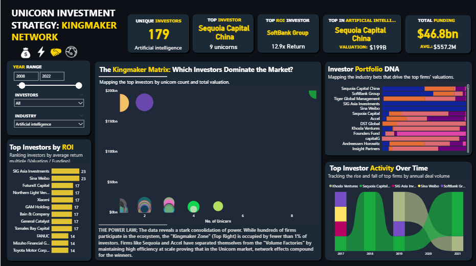
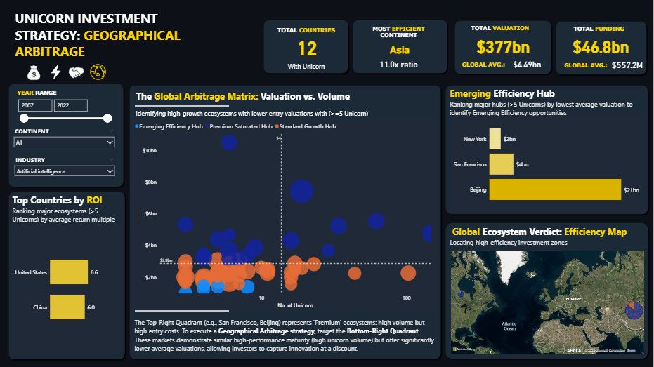

# Global Unicorn Arbitrage: Ecosystem Efficiency Dashboard

**Comparing startup valuation, funding intensity, growth speed, investor networks and geographic concentration across global unicorn ecosystems.**

**Project type:** Independent data analytics portfolio project  
**Dataset:** 1,074 unicorn companies, as reported in the original project analysis  
**Tools:** Microsoft SQL Server (T-SQL), Power BI  
**Focus:** Descriptive market analysis and exploratory investment screening—not investment-return forecasting

[View the interactive Power BI dashboard](https://app.powerbi.com/links/NDQXqXVVke?ctid=319a61c8-ee1e-4161-8f35-b9553227afd7&pbi_source=linkShare&bookmarkGuid=6aa14441-554f-4a07-b90e-b58e37eac958) | [Explore the SQL analysis](SQL_Query/SQL_query_for_Unicorn.sql)

> **Executive takeaway:** Unicorn valuations, funding requirements and formation rates vary substantially by industry, investor network and location. The analysis identifies candidates for further diligence, but valuation-based ratios are **not** realized investor returns, and high valuations do not establish that a market is inexpensive or investable.

## Table of Contents

- [1. Project Overview](#1-project-overview)
- [2. Business Problem & Analytical Questions](#2-business-problem--analytical-questions)
- [3. Dataset Overview & Tools](#3-dataset-overview--tools)
- [4. Analytical Framework & Methodology](#4-analytical-framework--methodology)
- [5. Executive Summary](#5-executive-summary)
- [6. Key Findings & Visualizations](#6-key-findings--visualizations)
  - [6.1 Capital Efficiency](#61-capital-efficiency)
  - [6.2 Industry Growth Velocity](#62-industry-growth-velocity)
  - [6.3 Investor Networks](#63-investor-networks)
  - [6.4 Global Ecosystem Comparison](#64-global-ecosystem-comparison)
  - [6.5 Market Structure & Historical Trends](#65-market-structure--historical-trends)
- [7. Recommendations & Business Implications](#7-recommendations--business-implications)
- [8. Limitations & Further Investigation](#8-limitations--further-investigation)
- [9. Project Files & Deliverables](#9-project-files--deliverables)
- [10. Potential Extensions](#10-potential-extensions)

---

## 1. Project Overview

A unicorn is a privately held company with a reported valuation of at least **US$1 billion**. This project examines a snapshot of global unicorn companies and asks how their valuation, disclosed funding, time to unicorn status, investor relationships and geographic distribution differ.

The **“ecosystem arbitrage”** concept is used as an exploratory comparison of startup hubs, not proof of an executable arbitrage opportunity. The dashboard distinguishes markets with relatively high average unicorn valuations or lower company counts from larger, more concentrated hubs. These are screening signals that warrant additional research, not measures of entry price or expected investment returns.

**Deliverable:** A Power BI dashboard supported by SQL Server preprocessing, descriptive metrics and network queries.

[Back to Table of Contents](#table-of-contents)

## 2. Business Problem & Analytical Questions

Headline unicorn counts and valuations alone offer an incomplete view of venture ecosystems. A useful screening exercise also considers capital raised, the time taken to reach unicorn status, industry mix, concentration and the investor relationships behind prominent companies.

This analysis addresses five questions:

1. **Capital intensity:** Which unicorns have high or low reported valuation relative to disclosed funding?
2. **Growth velocity:** Which industries have shorter observed times from founding to unicorn status?
3. **Investor concentration:** Which investors and co-investor pairs appear most frequently in the selected unicorn sample?
4. **Geographic structure:** How do unicorn counts and average valuations vary across countries and cities?
5. **Historical change:** How did unicorn formation and industry composition change around the 2021 peak and the subsequent 2022 slowdown?

The intended audience is an analyst or investment-research team building an initial screening shortlist. The project does **not** estimate actual fund performance, private-company fair value or investment eligibility.

[Back to Table of Contents](#table-of-contents)

## 3. Dataset Overview & Tools

The original project documentation describes a dataset of **1,074 global unicorn companies**. The source README does not identify a verifiable download URL, extraction date or last-refresh date; these should be added when the underlying dataset provenance is confirmed.

| Field | Role in the analysis |
|---|---|
| Company | Company identifier/name |
| Industry | Sector classification |
| Valuation | Reported company valuation (original data stored as currency strings) |
| Funding | Reported total funding raised (may include unknown values) |
| Year Founded | Formation year |
| Date Joined | Date of attaining reported unicorn status |
| Country, City, Continent | Geographic segmentation |
| Select Investors | Comma-separated list of selected investors |

**Software and methods**

| Tool | Actual role |
|---|---|
| Microsoft SQL Server (T-SQL) | Currency transformations, data shaping, descriptive aggregation, ranking, time comparisons and investor co-occurrence analysis |
| Power BI | Visual exploration of capital efficiency, velocity, investor activity and geography |

**Data-grain decision:** The company-level analytical table holds one row per unicorn for valuation and industry measures. A separate investor-long table represents the **company × investor** relationship. Investor joins must be handled carefully because they can multiply company valuations when summed across investors.

[Back to Table of Contents](#table-of-contents)

## 4. Analytical Framework & Methodology

The workflow follows a reporting structure similar to a business diagnostic project: **Validate → Transform → Segment → Compare → Interpret**.

1. **Validate:** Inspect required company, date, industry and financial fields; identify missing funding and invalid conversions.
2. **Transform:** Convert valuation/funding currency strings into numeric USD amounts and derive founding-to-unicorn intervals.
3. **Segment:** Group companies by industry, geography and reported investor relationships.
4. **Compare:** Calculate valuation-to-funding ratios, time-to-unicorn summaries, counts, ranks and cohort trends.
5. **Interpret:** Treat descriptive patterns as screening evidence, state limitations and identify follow-up diligence questions.

### Key measures and definitions

| Measure | Calculation / interpretation |
|---|---|
| Valuation-to-funding ratio | `reported_valuation_usd / reported_funding_usd`, for positive known funding; **not realized ROI** |
| Years to unicorn | `YEAR(date_joined) − year_founded`; a year-granularity approximation, not an exact duration |
| Value-velocity proxy | `reported_valuation_usd / years_to_unicorn`, excluding zero or invalid intervals; **not annual valuation growth** |
| Unicorn count | Number of companies in each segment of this snapshot |
| Average reported valuation | Mean valuation within a specified city/industry, sensitive to outliers and sample size |
| Co-investment frequency | Number of distinct companies shared by an investor pair |

The original SQL performs these calculations with temporary tables and aggregate queries. The complete script is available in [SQL_Query/SQL_query_for_Unicorn.sql](SQL_Query/SQL_query_for_Unicorn.sql).

**Selected example — valuation-to-funding screening metric:**

```sql
SELECT
    Company,
    Industry,
    Valuation_Num,
    Funding_Num,
    ROUND(Valuation_Num / NULLIF(Funding_Num, 0), 2)
        AS Valuation_To_Funding_Ratio
FROM #Unicorn_Analysis
WHERE Funding_Num IS NOT NULL
  AND Funding_Num > 0
ORDER BY Valuation_To_Funding_Ratio DESC;
```

This metric compares two reported amounts. It does not account for ownership percentages, investment dates, dilution, exits, cash returned or investment terms.

[Back to Table of Contents](#table-of-contents)

## 5. Executive Summary

The project's reported sample contains **1,074 unicorn companies**, with an estimated combined reported valuation of **$3.71 trillion**. The original analysis describes a highly concentrated market: **562 unicorns in the United States**, **148 in San Francisco** and **103 in New York**. It also identifies **520 companies with a recorded unicorn entry year of 2021**, making that year prominent in the dataset.

Across industries, the original analysis reports a mean **5.9-year founding-to-unicorn interval** for Artificial Intelligence and **5.03 years** for Auto & Transportation. It reports **205 Internet Software unicorns**, reflecting a large sector presence in the selected data. Company-level valuation-to-funding ratios vary widely, while investor co-occurrence analysis highlights concentration among well-connected venture firms.

**Overall conclusion:** These patterns are useful for identifying *where to investigate further*, but the project cannot infer realized investor returns, startup profitability, entry valuations, causal drivers of the 2021 spike, or a uniquely optimal city for venture-capital deployment.

[Back to Table of Contents](#table-of-contents)

## 6. Key Findings & Visualizations

### 6.1 Capital Efficiency

The valuation-to-funding comparison highlights substantial variation in reported company valuations relative to disclosed funding. The original analysis highlights companies such as **Zapier** and **Canva** among high-ratio observations, while **Magic Leap** and **Ola Cabs** appear in a lower-ratio group. Some reported outliers approach a **4,000×** valuation-to-funding ratio in the source analysis.

A high ratio may warrant investigation of business model, funding history and valuation timing; it does **not** demonstrate that the company generated a 4,000× investor return or achieved its valuation without substantial capital. Likewise, a ratio below 2× does not by itself establish cash burn or value destruction.


**Interpretation:** Reported valuation relative to funding is a screening proxy for apparent capital intensity, not a profitability or ROI measure.

**Business implication:** Analysts can use the ratio to create diligence lists, but should reconcile dates and funding coverage before comparing companies or industries.

**Recommended action:** Validate funding disclosures, business models, financing terms and valuation dates for extreme outliers.

[Back to Table of Contents](#table-of-contents)

### 6.2 Industry Growth Velocity

The original analysis reports an average time to unicorn status of approximately **5.9 years for Artificial Intelligence** and **5.03 years for Auto & Transportation**. Internet Software has **205 unicorns** in the selected sample and a reported value-velocity proxy of approximately **$500 million per year**, compared with approximately **$1.1 billion per year** for AI.

These statistics describe companies that *have already reached unicorn status*. They do not capture startups that never did, and a lower time-to-unicorn interval cannot independently establish stronger fundamentals or lower investment risk. The value-velocity proxy divides a reported valuation by years since founding; it is not an observed yearly return series.


**Interpretation:** Industries differ in how rapidly companies in this unicorn sample reached the $1 billion threshold.

**Business implication:** Use the sector comparisons to prioritise further review of funding requirements and business-model characteristics, not as stand-alone forecasts.

**Recommended action:** Compare cohort years, funding intensity and sample sizes, then test whether findings are robust to extreme valuations.

[Back to Table of Contents](#table-of-contents)

### 6.3 Investor Networks

The original project reports **1,247 investor names** in the analysed network, with relatively few names concentrated among investors linked to many unicorn companies. It highlights **Accel** (approximately **60** unicorn investments in the selected records) and **Sequoia Capital China** (approximately **$473 billion** in aggregate *portfolio-company* valuation, as reported in the project).

The investor-pair query counts companies shared by two named investors. The source analysis reports **nine shared unicorn investments** for Sequoia China and Tencent, and **six** for Accel and Y Combinator. These are **co-occurrence counts**, not evidence of formal syndicate leadership or investment-performance superiority.



**Interpretation:** Investor relationships are unevenly distributed across the selected unicorn records, and some pairs co-occur repeatedly.

**Business implication:** The network can support due-diligence mapping and identification of commonly co-invested companies. Summed company valuations are not the value owned by the investor or a measure of fund return.

**Recommended action:** Standardise investor names, check incomplete investor lists and distinguish investor-company exposure from actual ownership and investment returns.

[Back to Table of Contents](#table-of-contents)

### 6.4 Global Ecosystem Comparison

The analysis compares unicorn counts and reported average valuations by country and city. It describes a global unicorn sample valued at approximately **$3.71 trillion** and identifies both high-volume hubs and smaller markets with relatively high average company valuations. The source commentary references **Austin, Hangzhou, Stockholm, Shenzhen and Boston** among cities worth closer examination.

The underlying SQL ranks cities by **average reported unicorn valuation**, with a minimum observed count filter (`HAVING COUNT(*) > 2`). This can surface high-valuation outliers but does **not** measure a city's actual startup entry prices, VC deal competition or the cost of acquiring equity. Results for low-count cities can also be unstable.



**Interpretation:** Counts and average valuations highlight geographic concentration and variation within this sample.

**Business implication:** Geographic comparisons can help build a research shortlist, but the term *arbitrage* remains a framing device rather than a verified mispricing opportunity.

**Recommended action:** Add funding-stage-adjusted entry valuations, funding volumes, exit performance and consistent city-level coverage before ranking investment destinations.

[Back to Table of Contents](#table-of-contents)

### 6.5 Market Structure & Historical Trends

The original analysis highlights **520 unicorn entries in 2021**, alongside a subsequent decrease in new entries in 2022. It also reports **562 US unicorns** within the 1,074-company sample, including **148 in San Francisco** and **103 in New York**. The project examines industry composition and pre-2021 growth patterns through additional SQL queries.

The 2021 spike and subsequent slowdown are descriptive cohort patterns. Attributing them to low interest rates, pandemic behaviour or market correction would require external economic and financing evidence. Similarly, shifts in the share of newly created unicorns should not automatically be interpreted as changes in total venture investment or industry profitability.

**Interpretation:** The timing and geographic concentration of unicorn formation are distinctive features of the analysed snapshot.

**Recommended action:** Re-run the cohort analysis on a dated, consistently maintained source and compare results with venture-capital funding and macroeconomic indicators.

[Back to Table of Contents](#table-of-contents)

## 7. Recommendations & Business Implications

The results support **research prioritisation**, not immediate investment execution.

| Priority | Analytical opportunity | Recommended action | Success criterion |
|---|---|---|---|
| High | Extreme valuation-to-funding ratios | Verify funding completeness, valuation dates, company financials and ownership structure | Ratios supported by consistent, dated records |
| High | Fast unicorn formation in selected industries | Review industry/cohort sample sizes, survival bias and capital needs | Comparable sector-level metrics with sensitivity checks |
| High | Concentrated investor networks | Resolve investor aliases; validate co-investment pairs against external records | Reliable entity-matched network statistics |
| Medium | High-valuation but lower-count cities | Compare actual deal entry prices, stages, liquidity and exits | Geography comparisons informed by investment terms, not averages alone |
| Ongoing | Historic unicorn waves | Monitor cohorts against contemporaneous VC activity and macro indicators | Dated updates and clearly separated observation vs. interpretation |

**Expected value:** A better-documented shortlist for additional research, more transparent screening criteria and fewer misleading comparisons. No investment return or cost saving has been established by this project.

[Back to Table of Contents](#table-of-contents)

## 8. Limitations & Further Investigation

1. **Dataset provenance and timing:** The original README does not specify a source URL, extraction date, refresh date or validation report. Its figures should be read as *reported project results* until checked against the raw dataset.
2. **Selection and survivorship bias:** Unicorn-only records exclude most startups that did not reach a billion-dollar valuation. Results cannot be generalized to all funded startups.
3. **Reported valuations are not realized returns:** Company valuations and cumulative funding do not establish ROI, cash flows, dilution-adjusted multiples or fund-level performance. The original labels “ROI,” “return multiple,” and “cash burner” are therefore not used as verified conclusions.
4. **Valuation/funding comparability:** Funding may be incomplete or not aligned with valuation dates. Missing and zero funding require explicit handling.
5. **Growth-velocity measurement:** `YEAR(date_joined) − year_founded` is approximate. Valuation divided by elapsed years is a proxy, not a measured annual growth rate.
6. **Investor attribution:** Investor lists may be partial; assigning an entire company's valuation to every named investor double-counts exposure and cannot estimate ownership value.
7. **Geographic conclusions:** Average valuations and counts do not measure deal access, entry price or geographic investment arbitrage.
8. **Macroeconomic explanations:** The analysis describes the 2021 spike and 2022 slowdown but does not independently establish their causes.

### Additional evidence that would improve the project

| Area | Additional evidence | Purpose |
|---|---|---|
| Capital efficiency | Dated funding rounds, valuations, dilution, revenues and exits | Separate valuation proxies from realized performance |
| Sector velocity | Founding and unicorn dates, full startup cohorts, failure data | Reduce timing error and survivorship bias |
| Investor network | Standardized investor IDs, ownership stakes, complete round histories | Improve network reliability and economic interpretation |
| Geographic comparison | Stage-adjusted deal prices, funding availability, exits and liquidity | Test whether alleged efficiency hubs are investable or underpriced |
| Historical trends | Dated unicorn snapshots and contemporaneous VC/macro data | Support robust cohort and contextual comparisons |

[Back to Table of Contents](#table-of-contents)

## 9. Project Files & Deliverables

| Resource | Description |
|---|---|
| [Interactive Power BI dashboard](https://app.powerbi.com/links/NDQXqXVVke?ctid=319a61c8-ee1e-4161-8f35-b9553227afd7&pbi_source=linkShare&bookmarkGuid=6aa14441-554f-4a07-b90e-b58e37eac958) | Dashboard published at the link in the original project README; access depends on Power BI permissions |
| [Main SQL analysis script](SQL_Query/SQL_query_for_Unicorn.sql) | Cleaning, derived metrics, trends, comparisons and investor network queries |
| [Capital efficiency chart](dashboard_pic/CAPITAL_EFFICIENCY.PNG) | Valuation-to-funding screening |
| [Industry velocity chart](dashboard_pic/high_growth_velocity.PNG) | Industry growth-velocity proxies |
| [Investor network chart](dashboard_pic/kingmaker_network.PNG) | Investor concentration and co-occurrence |
| [Geography chart](dashboard_pic/GEOGRAPHICAL_ARBITRAGE.PNG) | Geographic valuation/count comparisons |

**Repository note:** These paths are retained from the uploaded README. Confirm that the corresponding files exist with the exact spelling and capitalization in the GitHub repository. The full underlying dataset and Power BI source file were not included with the uploaded README and should only be listed as downloadable deliverables if they are actually provided.

[Back to Table of Contents](#table-of-contents)

## 10. Potential Extensions

1. **Unicorn prediction research:** Explore a carefully time-split model using information available before unicorn status, with negative examples and leakage controls.
2. **Investor network visualization:** Build a graph of investor-company and investor-pair relationships, with consistent entity IDs and coverage checks.
3. **News sentiment and funding cycles:** Compare dated media sentiment with funding activity and reported valuations while testing temporal direction and confounding factors.

These are **future research ideas**, not completed parts of the current project.

[Back to Table of Contents](#table-of-contents)
