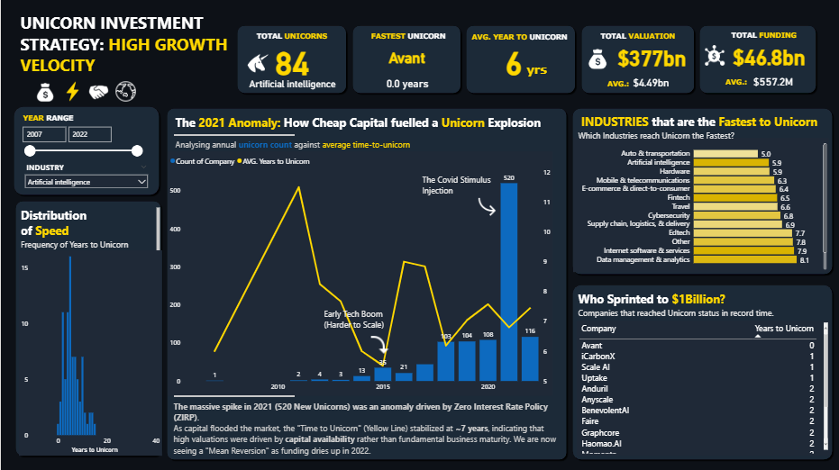

# Global Unicorn Ecosystem Analytics | Venture Capital & Market Intelligence

**Project type:** Independent data analytics portfolio

**Reporting scope:** Historical global unicorn cohort snapshot (1,074 companies across 46 countries, through 2022 entries)

**Business context:** Venture capital ecosystem screening across capital efficiency, sector growth velocity, geographic hubs, and investor syndicates

**Primary tools:** Microsoft SQL Server (T-SQL) & Power BI (DAX, Power Query, interactive dashboards)

[View the interactive Power BI dashboard](https://app.powerbi.com/links/NDQXqXVVke?ctid=319a61c8-ee1e-4161-8f35-b9553227afd7&pbi_source=linkShare&bookmarkGuid=6aa14441-554f-4a07-b90e-b58e37eac958) | [Explore the SQL analysis script](SQL_Query/SQL_query_for_Unicorn.sql)

## Table of Contents

* [1. Project Overview](#1-project-overview)

* [2. Business Problem & Stakeholders](#2-business-problem--stakeholders)

* [3. Dataset Overview & Tools](#3-dataset-overview--tools)

* [4. Executive Summary](#4-executive-summary)

* [5. Key Findings & Visualizations](#5-key-findings--visualizations)

  * [5.1 Capital Efficiency (The Moneyball Matrix)](#51-capital-efficiency-the-moneyball-matrix)

  * [5.2 Industry Growth Velocity (Sprinters vs. Marathon Builders)](#52-industry-growth-velocity-sprinters-vs-marathon-builders)

  * [5.3 Geographic Ecosystem Comparison (Volume vs. Valuation Quality)](#53-geographic-ecosystem-comparison-volume-vs-valuation-quality)

  * [5.4 Investor Syndicate Network (The "Kingmaker" Wiring)](#54-investor-syndicate-network-the-kingmaker-wiring)

  * [5.5 Market Structure & The 2021 Liquidity Anomaly](#55-market-structure--the-2021-liquidity-anomaly)

* [6. Recommendations & Business Implications](#6-recommendations--business-implications)

* [7. Limitations & Further Investigation](#7-limitations--further-investigation)

* [8. Project Files & Deliverables](#8-project-files--deliverables)

## 1. Project Overview

A unicorn is a privately held startup valued at **US\$1 billion or more**. This study examines a global snapshot of **1,074 unicorn companies** (representing **\$3.71 trillion** in combined reported valuation) to understand *how capital efficiency, growth velocity, geographic concentration, and investor networks differ across venture ecosystems*.

The analysis combines currency-normalized financial figures, founding-to-unicorn duration modeling, geographic benchmarking, and co-investment network queries. It distinguishes documented screening signals from unverified causal claims or realized fund returns.

**Scope:** Multi-decade historical unicorn cohort snapshot (with specific cohort isolation around the 2021 liquidity spike and 2022 market correction).

[↑ Back to Table of Contents](#table-of-contents)

## 2. Business Problem & Stakeholders

Headline unicorn counts and aggregate valuations offer an incomplete—and often misleading—view of global venture markets. In this dataset, **52.3% of all unicorns (562 companies)** are concentrated in the United States, and **48.4% (520 companies)** reached unicorn status during a single anomalous year (2021). Relying purely on raw unicorn headcount obscures capital burn, survivorship dynamics, and smaller high-efficiency hubs.

An investment-research or venture-strategy team building an initial screening shortlist therefore commissioned an exploratory investigation to evaluate five core ecosystem dimensions:

| Ecosystem Dimension | Key Headline Metric | Analytical Significance | 
| ----- | ----- | ----- | 
| Total Global Footprint | **1,074 unicorns (\$3.71T)** | Establish baseline valuation and sector composition | 
| Capital Efficiency | **<0.7x to 4,000x ratio** | Separate product-led leverage from capital-intensive cash burn | 
| Sector Growth Velocity | **5.03 yrs to 8.08 yrs** | Compare time-to-\$1B against annual value-velocity proxies | 
| Geographic Concentration | **562 US / 148 SF / 103 NYC** | Contrast high-volume hubs against high-average-valuation cities | 
| Historical Cohort Shift | **520 entries in 2021** | Isolate macro liquidity anomalies from pre-COVID baseline trends | 

The **Head of Venture Research** needed to identify which sectors, hubs, and investor networks warrant deeper due diligence. Different market assumptions were framed as hypotheses to test rather than accept at face value:

| Market Assumption / Stakeholder Lens | Initial Hypothesis to Test | 
| ----- | ----- | 
| Growth Equity | High-volume hubs (San Francisco, Beijing, London) also yield the highest average valuation per startup | 
| Sector Strategy | Software startups always reach \$1B faster than hardware or mobility companies | 
| Capital Allocation | High unicorn valuations automatically indicate strong capital efficiency and low burn | 
| Syndicate Sourcing | Unicorn backing is broadly distributed rather than concentrated among repeat co-investor blocs | 

[↑ Back to Table of Contents](#table-of-contents)

## 3. Dataset Overview & Tools

The project transforms a raw flat table (`Unicorn_Company`) into a normalized two-table analytical model documented in the [Data Dictionary](Global_Unicorn_Data_Dictionary.md):

| Source / Output Table | Role in the analysis | Grain / analytical caution | 
| ----- | ----- | ----- | 
| `Unicorn_Company` | Raw company attributes, currency strings, and comma-delimited investor lists | Source-record level; unparsed currency strings and multi-value investor text | 
| `Fact_Unicorn.csv` | Cleaned valuations, funding totals, durations, and efficiency classifications | **One row per `Company_ID`**; authoritative table for all valuation and funding sums | 
| `Bridge_Investors.csv` | Exploded investor-company pairs (`CROSS APPLY STRING_SPLIT`) for syndicate analysis | **One row per `Company_ID` × `Investor`**; **coarser/multi-row grain**—never sum company valuations directly across this table | 

**Tooling actually used:** Microsoft SQL Server (T-SQL for currency parsing, city-state `NULL` imputation, window functions, and self-join co-investment matrices) and Power BI (DAX measures, star-schema modeling, and interactive visual storytelling).

> The complete preprocessing pipeline and analytical queries are preserved in [SQL_Query/SQL_query_for_Unicorn.sql](SQL_Query/SQL_query_for_Unicorn.sql).

[↑ Back to Table of Contents](#table-of-contents)

## 4. Executive Summary

Across **1,074 global unicorns (\$3.71 trillion combined valuation)**, ecosystem performance diverges sharply between **capital-efficient software models** and **capital-intensive physical industries**. Software and fintech leaders such as **Zapier (\~4,000x ratio)**, **Canva**, and **SHEIN** achieved massive valuations relative to disclosed funding, whereas mobility and hardware firms like **Magic Leap (0.67x)** and **Ola Cabs** raised more capital than their reported valuations.

Sector velocity analysis shows that **Auto & Transportation** reaches \$1B fastest (**5.03 years** on average) due to heavy upfront mega-rounds, while **Artificial Intelligence** combines rapid speed (**5.90 years**) with strong value velocity (**\$1.1B/year**), outpacing mature **Internet Software & Services (\$500M/year; 205 unicorns)**. Geographically, specialized ecosystems such as **Stockholm (\$10.5B avg)**, **Shenzhen (\$7.4B avg)**, and **Boston (\$4.3B avg)** outperform much larger volume hubs on average valuation per company, while repeat co-investor alliances—led by **Sequoia Capital China + Tencent (9 shared unicorns)** and **Y Combinator + Accel (6 shared unicorns)**—anchor global deal flow.

**Decision:** Prioritise due diligence on capital-efficient software/AI cohorts, specialized deep-tech hubs, and repeat syndicate pipelines, while auditing funding completeness and post-2021 valuation resets before treating descriptive ratios as investable entry benchmarks.

[↑ Back to Table of Contents](#table-of-contents)

## 5. Key Findings & Visualizations

The interactive Power BI dashboard provides the consolidated four-page executive view. Detailed breakdowns across each analytical dimension follow below.

### 5.1 Capital Efficiency (The Moneyball Matrix)

Comparing reported valuation against disclosed cumulative funding (`Valuation_Num / Funding_Num`) reveals a stark structural divide between asset-light software ("bits") and capital-intensive physical operations ("atoms").

At the top of the distribution, product-led software and fintech companies demonstrate extraordinary valuation leverage: **Zapier** reached a **\$4B valuation** on roughly **\$1M in disclosed funding (\~4,000x ratio)**, alongside **Dunamu**. Crucially, efficiency is not limited to smaller unicorns—decacorns **SHEIN (\$100B valuation)** and **Canva (\$40B valuation)** maintained **50x–70x ratios** at massive scale, reflecting strong unit economics capable of self-funding expansion.

By contrast, the bottom tier (**Cash Burners, <2x ratio**) is heavily concentrated in **Auto & Transportation** and hardware—including **Magic Leap (\~0.67x)**, **Fair**, **Snapdeal**, **Ola Cabs**, and **WM Motor**. These companies raised more cumulative capital than their current reported valuations, illustrating the capital intensity of manufacturing vehicles, leasing fleets, and building physical infrastructure.

**Business Implication:**  
Capital intensity fundamentally alters risk-return dynamics and portfolio construction across venture sectors. Asset-light software and marketplace models (`Elite Efficiency 10x+`) require significantly less dilutive follow-on equity to scale, preserving ownership stakes and insulating investors when late-stage capital markets tighten. Conversely, capital-intensive physical industries (`Cash Burners <2x`) demand massive continuous funding to build factories, fleets, or hardware—exposing late-stage investors to severe valuation compression and down-round risk if growth decelerates. Screening pipelines must therefore separate operational unit-economics leverage from headline valuation size rather than treating all \$1B+ valuations as structurally equivalent.

### 5.2 Industry Growth Velocity (Sprinters vs. Marathon Builders)

Evaluating average founding-to-unicorn duration (`Avg_Years_To_Unicorn`) alongside annual value creation (`Valuation_Num / Years_To_Unicorn`) across sectors with significant sample sizes ($n > 10$) distinguishes rapid capital-driven "sprinters" from long-horizon "marathon builders."

**Artificial Intelligence** emerges as the premier hyper-growth sector, reaching unicorn status in **5.90 years** on average—roughly two years faster than traditional software—while generating the **second-highest value velocity (\$1.10B/year)**. **Auto & Transportation** records the fastest overall time to \$1B at **5.03 years**, largely because massive early capital injections push valuations past the billion-dollar mark early in the company lifecycle.

Conversely, **Consumer & Retail** posts the **#1 value velocity (\$1.25B/year)** despite requiring **8.08 years** on average to reach unicorn status, reflecting a winner-takes-all dynamic skewed by mega-outliers such as **SHEIN** and **Juul**. Meanwhile, **Internet Software & Services** leads total unicorn volume (**205 companies**) but records the lowest value velocity among major sectors (**\$500M/year**), signaling market maturity and heavier competition.

| Sector Profile | Representative Sector | Avg. Years to Unicorn | Value Velocity Proxy | Structural Pattern | 
| ----- | ----- | ----- | ----- | ----- | 
| Speed Sprinter | Auto & Transportation | **5.03 yrs** | Capital-intensive early rounds | Fast \$1B threshold driven by heavy upfront capex | 
| Hyper-Growth Leader | Artificial Intelligence | **5.90 yrs** | **\$1.10B / yr** | Rapid enterprise adoption + high valuation multiples | 
| Marathon Blockbuster | Consumer & Retail | **8.08 yrs** | **\$1.25B / yr** | Slow brand/supply-chain build, skewed by mega-winners | 
| Mature Volume Engine | Internet Software & Services | \~7.90 yrs | **\$500M / yr** | High unicorn count (205), lower per-company velocity | 

**Business Implication:**  
Speed to a \$1B valuation is an insufficient standalone indicator of sector attractiveness because capital-heavy industries can reach unicorn status rapidly through sheer early-round fundraising volume rather than organic revenue momentum. For investment strategy teams, pairing time-to-unicorn with value velocity reveals a crucial sector rotation: general Internet Software has entered a mature, crowded phase with lower per-company value acceleration (\$500M/yr), whereas Artificial Intelligence combines rapid scaling (5.90 years) with high annual value creation (\$1.10B/yr). Sourcing models weighted exclusively toward historical unicorn headcount risk over-allocating to saturated software categories while missing faster-compounding frontier sectors.

### 5.3 Geographic Ecosystem Comparison (Volume vs. Valuation Quality)

Segmenting unicorns by `Continent`, `Country`, and `City` (`HAVING COUNT(*) > 2`) demonstrates that raw startup volume and average valuation per unicorn rarely peak in the same location. While the **United States leads global volume with 562 unicorns**—anchored by **San Francisco (148)** and **New York City (103)**—several specialized secondary hubs command significantly higher average valuations per company.

In Europe, **London** dominates headcount (**34 unicorns**), but **Stockholm** ranks **#1 in Europe by average valuation (\$10.5B across 6 unicorns**, anchored by giants such as Klarna). In Asia, **Beijing** leads volume (**63 unicorns**), whereas hardware- and manufacturing-centric **Shenzhen** takes the top regional spot for average valuation (**\$7.4B**).

A similar quality-versus-volume contrast appears within North America: despite New York City hosting more than six times as many unicorns as **Boston (103 vs. 16)**, Boston commands nearly double the average valuation (**\$4.3B vs. \$2.2B**), driven by capital-rich Biotech and Robotics ventures compared to NYC's broader tail of smaller fintech and media startups. In South America, **São Paulo** leads the continent with a **\$2.4B** average valuation comparable to Berlin and Paris.

**Business Implication:**  
Venture sourcing strategies confined exclusively to top-headcount hubs (San Francisco, New York, Beijing, London) risk overlooking specialized deep-tech, hardware, and biotech ecosystems where winning companies scale to substantially higher average valuations. While high city averages reflect concentrated decacorn outliers rather than discounted equity entry prices, ecosystems like Boston, Stockholm, and Shenzhen demonstrate stronger per-startup value concentration due to specialized technical talent pools and industrial supply chains. Geographic market coverage should therefore balance high-frequency deal flow in generalist hubs with targeted, thesis-driven scouting in specialized regional centers.

### 5.4 Investor Syndicate Network (The "Kingmaker" Wiring)

Self-joining the normalized `#Investor_Long` bridge table across **1,247 distinct investor names** reveals that unicorn backing is tightly clustered around repeat co-investment alliances rather than randomly distributed across venture firms.

At the global network level, **Accel** emerges as the ecosystem's central "super-connector," appearing in approximately **60 unicorn records** and **8 of the top 50 bilateral co-investment pairs**, while **Sequoia Capital China** leads aggregate portfolio-company valuation exposure (**\~\$473B** across its backed unicorns).

Bilateral syndicate pairing (`COUNT(DISTINCT Company) >= 3`) surfaces three distinct regional power blocs:

1. **The China Capital + Distribution Axis (`Sequoia Capital China` + `Tencent`):** Ranks #1 globally with **9 shared unicorns** (including VIPKid and Airwallex), pairing institutional venture governance with WeChat/ecosystem distribution.

2. **The Silicon Valley Graduation Pipeline (`Y Combinator`** $\rightarrow$ **`Accel`):** Ranks #2 globally with **6 shared unicorns** (including Checkr and Scale AI), illustrating a structured accelerator-to-growth-round handoff.

3. **The India Digital Growth Bloc (`Sequoia Capital India` + `Tiger Global` + `Lightspeed India`):** Repeatedly co-invests across Indian fintech and consumer platforms (including Razorpay, CRED, and BYJU'S).

**Business Implication:**  
Unicorn formation is heavily mediated by structured institutional pipelines rather than isolated, one-off investments. In emerging ecosystems such as China and India, winning startups frequently pair top-tier venture capital with strategic corporate distribution or coordinated multi-fund growth syndicates, whereas Silicon Valley exhibits clear stage-to-stage graduation pathways from seed accelerators (`Y Combinator`) into growth-round leaders (`Accel`). For corporate development and co-investment teams, tracking early-stage portfolios backed by feeder accelerators alongside repeat Series B/C syndicate partners provides an actionable leading indicator of startups entering high-probability scaling trajectories.

### 5.5 Market Structure & The 2021 Liquidity Anomaly

Analyzing annual unicorn entry cohorts (`Year_Joined`) explains how macroeconomic liquidity shaped the dataset's composition. Unicorn formations accelerated sharply to **520 new entries in 2021**—nearly half of the entire 1,074-company population—before dropping substantially in 2022.

However, benchmarking 2022 actual entries against the **2018–2020 pre-COVID annual average** demonstrates that 2022 represented a **mean-reversion correction** rather than a structural collapse below pre-pandemic norms. Sector-level cohort tracking shows sharp divergence during this reset: pandemic-era beneficiaries such as **Consumer & Retail** and **Edtech** saw new unicorn creation fall by **more than 90%** in 2022, whereas foundational sectors maintained structural share—with **Fintech** expanding from **11.0% (2016) to 26.7% (2022)** and **AI/Big Data** rising from **9.8% (2020) to 12.3% (2022)**.

**Business Implication:**  
Pooling multi-year unicorn data without cohort segmentation creates severe valuation and growth distortion because 2021 liquidity conditions temporarily inflated entry counts across nearly every sector. Evaluating 2022 against pre-pandemic baselines (2018–2020) proves that the venture ecosystem experienced a healthy normalization rather than a structural breakdown—separating transient pandemic-driven consumer/edtech hype from durable structural adoption in Fintech, AI, and B2B software. Financial benchmarking and comparable-company analyses must therefore anchor on pre-2021 and post-correction cohorts rather than treating 2021 peak multiples as repeatable market norms.

[↑ Back to Table of Contents](#table-of-contents)

## 6. Recommendations & Business Implications

The exploratory investigation identifies **capital-efficient software/AI models, specialized deep-tech ecosystems, and repeat syndicate pipelines** as the highest-priority screening dimensions, while flagging **2021 valuation inflation and capital-intensive cash burn** as key risk filters.

The recommendations below prioritize research actions by analytical signal strength and required validation:

| Priority | Ecosystem Signal / Risk | Recommended Action | Expected Research Outcome | Success Metrics | 
| ----- | ----- | ----- | ----- | ----- | 
| **Critical** | Extreme valuation-to-funding ratios (Zapier \~4,000x; SHEIN/Canva 50x–70x) alongside incomplete funding fields. | Audit disclosed funding rounds, secondary sales, and financing terms before using ratios to benchmark efficiency. | Eliminate false-positive efficiency outliers caused by partial funding disclosures. | Verified funding coverage %, reconciled valuation dates, adjusted efficiency ratio. | 
| **High** | AI combines rapid time-to-\$1B (5.90 yrs) with \$1.1B/yr velocity, while Auto/Mobility exhibits <2x efficiency. | Weight sector screening toward AI and capital-efficient Fintech/B2B SaaS; apply strict burn and unit-economics filters to hardware/mobility. | Focus diligence bandwidth on sectors with stronger operating leverage and post-2021 resilience. | Sector cohort survival rate, gross margin benchmarks, burn multiple. | 
| **High** | Specialized hubs (Stockholm \$10.5B, Shenzhen \$7.4B, Boston \$4.3B) outperform volume hubs on average valuation. | Expand deal-sourcing coverage beyond SF/NYC/London/Beijing to track specialized deep-tech and biotech clusters. | Surface high-value ecosystem leaders earlier with less crowded generalist competition. | Regional deal coverage, stage-adjusted entry multiples, local exit liquidity. | 
| **Medium** | Repeat co-investor alliances (Sequoia China/Tencent, YC/Accel, Sequoia India/Tiger) cluster around unicorn cohorts. | Build a syndicate-tracking watchlist monitoring Series A/B companies backed by top feeder accelerators and super-connectors. | Identify pre-unicorn candidates entering established growth-round pipelines earlier. | Syndicate co-investment hit rate, Series A-to-unicorn conversion time. | 
| **Ongoing** | 2021 cohort entries (520 unicorns) distort multi-year averages if pooled unadjusted. | Maintain cohort-segmented benchmarks (`2012–2020`, `2021`, `2022+`) in Power BI slicers and SQL views. | Prevent macro liquidity spikes from inflating baseline valuation and velocity expectations. | Cohort-adjusted median valuation, YoY entry variance vs. pre-2020 baseline. | 

### Implementation Priorities

**1. Immediate Priority — Data & Funding Verification**

Before acting on top-decile `Capital_Efficiency_Ratio` rankings, reconcile disclosed funding against external venture databases to confirm that high ratios reflect true bootstrapping rather than undisclosed private rounds.

**2. Secondary Priority — Cohort-Adjusted Sector Screening**

Use the Power BI dashboard's cohort filters to isolate pre-2021 and 2022 resilient cohorts (AI, Fintech, B2B SaaS) when setting valuation and time-to-scale benchmarks.

**3. Strategic Priority — Hub & Syndicate Sourcing**

Pair geographic tracking of specialized hubs (Boston, Stockholm, Shenzhen) with network monitoring of repeat co-investor pairs (`YC + Accel`, `Sequoia + regional leaders`).

### Expected Business Impact

Applying these screening filters creates a **more disciplined, risk-adjusted due-diligence shortlist** and prevents misleading comparisons across incompatible business models or macro regimes. Because this dataset captures post-hoc unicorn snapshots without entry prices or exit cash flows, **these findings guide research prioritization rather than guaranteeing realized fund returns**.

[↑ Back to Table of Contents](#table-of-contents)

## 7. Limitations & Further Investigation

While the SQL pipeline and Power BI dashboard establish clear descriptive patterns across global unicorn ecosystems, several structural limitations govern how these results should be interpreted.

### 7.1 Limitations of the Analysis

**1. Survivorship and Selection Bias**

The dataset exclusively contains companies that achieved a \$1B+ valuation. It excludes startups that failed, plateaued, or exited below \$1B. Consequently, sector velocity and efficiency averages describe *successful unicorn survivors* rather than the base-rate probability of any newly funded startup reaching unicorn status.

**2. Reported Valuations Are Not Realized Investor Returns**

`Valuation_Num / Funding_Num` compares headline post-money valuation against cumulative disclosed funding. It does not account for investor ownership percentages, dilution across rounds, liquidation preferences, secondary share sales, or realized IPO/M&A cash exits.

**3. Annual Founding-Year Granularity**

Source records provide `[Year Founded]` as an integer year rather than a full calendar date. As a result, `Years_To_Unicorn` (`Year_Joined - [Year Founded]`) is an integer-year approximation, and same-calendar-year unicorns (`0` years) are labeled `"Less than a year"` rather than imputing unverified month durations.

**4. Partial Investor Lists and Unmerged Entity Aliases**

The `[Select Investors]` field captures prominent selected backers rather than complete cap tables. Additionally, regional venture arms (such as *Sequoia Capital*, *Sequoia Capital China*, and *Sequoia Capital India*) appear as separate entities, and assigning a company's full valuation to each listed investor measures total portfolio exposure rather than owned equity value.

**5. Static Historical Snapshot**

The dataset reflects a static historical snapshot through 2022 entries without a verified live refresh feed. Subsequent down-rounds, bankruptcies, IPOs, or the post-2022 generative AI unicorn wave are not captured.

### 7.2 Areas for Further Investigation

| Investigation Area | Additional Data Required | Analytical Objective | 
| ----- | ----- | ----- | 
| Capital Efficiency | Round-by-round funding dates, post-money valuations, revenue bands, and exit proceeds | Distinguish true capital-efficient cash generation from incomplete funding disclosures or late-stage multiple expansion. | 
| Sector Velocity | Full startup cohort data (including non-unicorns) and exact founding dates (`YYYY-MM-DD`) | Eliminate survivorship bias and measure true hazard/conversion rates from Seed/Series A to unicorn status. | 
| Geographic Ecosystem Comparison | Stage-adjusted entry valuations, local VC dry powder, and regional M&A/IPO exit volumes | Test whether high-average hubs (Stockholm, Shenzhen, Boston) offer attractive entry pricing or simply reflect concentrated winners. | 
| Syndicate Networks | Parent-firm entity mapping table and lead-investor round tags | Consolidate global VC affiliates alongside branch views and separate lead-round conviction from follow-on participation. | 
| Macro & Cohort Cycles | External PitchBook/NVCA quarterly funding totals and central bank interest-rate series | Quantify how much of the 2021 spike and 2022 correction resulted from macro liquidity versus sector fundamentals. | 

### Overall Assessment

This project provides a structured, multi-dimensional diagnostic of global unicorn ecosystems—demonstrating how combining star-schema SQL modeling with interactive Power BI visual analysis moves venture screening beyond simplistic headcount rankings. Moving from exploratory screening to live investment execution requires integrating round-level pricing, non-unicorn failure baselines, and refreshed post-2022 market data.

[↑ Back to Table of Contents](#table-of-contents)

## 8. Project Files & Deliverables

| File | What it contains | 
| ----- | ----- | 
| [Interactive Power BI dashboard](https://app.powerbi.com/links/NDQXqXVVke?ctid=319a61c8-ee1e-4161-8f35-b9553227afd7&pbi_source=linkShare&bookmarkGuid=6aa14441-554f-4a07-b90e-b58e37eac958) | Four-page interactive report covering Capital Efficiency, Sector Velocity, Syndicate Networks, and Geographic Ecosystem Comparison | 
| [SQL analysis script](SQL_Query/SQL_query_for_Unicorn.sql) | T-SQL currency parsing, city-state `NULL` imputation, star-schema table creation, cohort trends, and co-investment queries | 
| [Data dictionary](Global_Unicorn_Data_Dictionary.md) | Table grain specifications, field definitions, data types, and derived metric formulas | 
| [Capital efficiency chart](dashboard_pic/CAPITAL_EFFICIENCY.PNG) | Visual breakdown of valuation-to-funding ratios and efficiency categories | 
| [Industry velocity chart](dashboard_pic/high_growth_velocity.PNG) | Sector comparison of average years to unicorn and value velocity per year | 
| [Investor network chart](dashboard_pic/kingmaker_network.PNG) | Super-connector investor concentration and bilateral co-investment pairs | 
| [Geographic ecosystem chart](dashboard_pic/GEOGRAPHICAL_ARBITRAGE.PNG) | Country and city comparison of unicorn volume vs. average valuation | 

**Note on reproducibility:** Run [SQL_Query/SQL_query_for_Unicorn.sql](SQL_Query/SQL_query_for_Unicorn.sql) against the raw `Unicorn_Company` source table in Microsoft SQL Server to reproduce `Fact_Unicorn.csv` and `Bridge_Investors.csv` before refreshing the Power BI model.

[↑ Back to Table of Contents](#table-of-contents)
